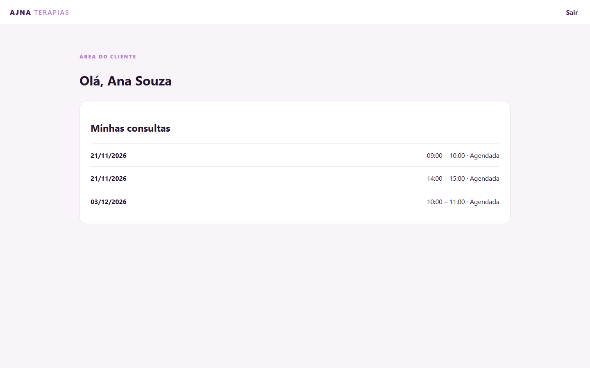
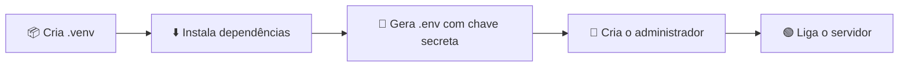
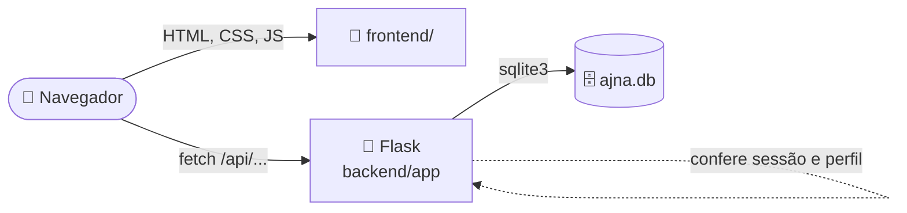
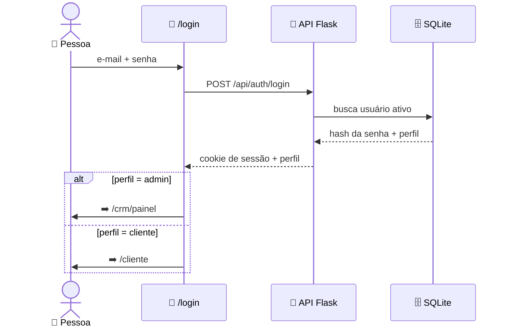
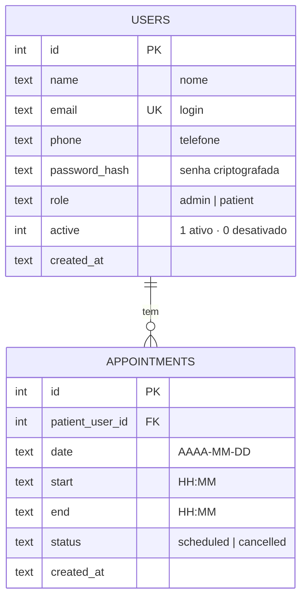

<div align="center">


# 🪷 Ajna Terapias

**Site institucional + CRM da clínica, com área do cliente e painel administrativo**

<p>
  
  
  
  
</p>
<p>
  
  
  
  
  
</p>

[🚀 Como rodar](#-como-rodar) •
[📸 Telas](#-telas) •
[🧱 Arquitetura](#-arquitetura) •
[🗄️ Banco de dados](#️-banco-de-dados) •
[🔌 API](#-api) •
[🔐 Segurança](#-segurança) •
[🌐 Publicação](#-colocando-na-web) •
[🗺️ Roadmap](#️-roadmap)


</div>

---

## 📖 Sobre o projeto

O **Ajna Terapias** é o site do Instituto Ajna, um espaço de terapias integrativas (acupuntura, reiki, auriculoterapia, ventosaterapia, shiatsu, reflexologia e massagens). O projeto tem **duas partes**:

| | Parte | O que faz |
|:-:|---|---|
| 🌸 | **Site público** | Apresenta a clínica, a história, os serviços e os canais de contato (WhatsApp e Instagram). |
| 🔒 | **CRM** | Área restrita com **login**. O administrador gerencia os clientes, e cada cliente acompanha as próprias consultas. |

> [!NOTE]
> O site **não usa GitHub Pages**: como tem login e banco de dados, ele roda em um **servidor Python**, no seu computador ou em uma hospedagem.

---

## ✨ Funcionalidades

<table>
<tr>
<td width="50%" valign="top">

### 🌐 Site público
- 🪷 Abertura animada com a identidade visual roxa
- 📜 Seção "Sobre" com a história do instituto
- 💆 Carrossel com as **7 técnicas** de terapia
- 💬 Contato direto por WhatsApp e Instagram
- 📱 Layout responsivo (computador e celular)

</td>
<td width="50%" valign="top">

### 🔐 CRM
- 🔑 **Login único** para clientes e administração
- 🧭 Cada perfil vai para a área certa automaticamente
- 👤 Admin **cria acesso** de cliente (nome, e-mail, telefone, senha)
- 🔁 Admin **redefine senha** e **ativa/desativa** clientes
- 📊 Painel com totais de clientes e consultas do dia
- 📅 Cliente vê **as próprias consultas**

</td>
</tr>
</table>

---

## 📸 Telas

<details open>
<summary><b>🔑 Login: clientes e administração</b></summary>
<br>


| ❌ Senha errada | 📱 No celular |
|:-:|:-:|
|  |  |

</details>

<details open>
<summary><b>🛠️ Painel do administrador</b></summary>
<br>


</details>

<details>
<summary><b>🙋 Área do cliente</b></summary>
<br>



</details>

<details>
<summary><b>💆 Seção de serviços do site</b></summary>
<br>


</details>

> 💡 Os nomes e e-mails nas telas são **dados fictícios de demonstração**.

---

## 🚀 Como rodar

### ✅ Pré-requisito
- 🐍 **Python 3.12** ([python.org](https://www.python.org/downloads/), marque *"Add to PATH"*) ou:
  ```powershell
  winget install --id Python.Python.3.12 -e
  ```

### ⚡ Jeito rápido: um comando só

Na pasta do projeto, no PowerShell:

```powershell
powershell -ExecutionPolicy Bypass -File .\iniciar.ps1 -Admin
```

O script [`iniciar.ps1`](iniciar.ps1) faz tudo sozinho:



Depois abra 👉 **http://127.0.0.1:5000/login**

Nas próximas vezes, rode sem o `-Admin`:

```powershell
powershell -ExecutionPolicy Bypass -File .\iniciar.ps1
```

<details>
<summary><b>🧩 Passo a passo manual (o que o script faz por dentro)</b></summary>

| # | Etapa | Comando |
|:-:|---|---|
| 1 | Criar o ambiente virtual | `py -m venv .venv` |
| 2 | Instalar as dependências | `.\.venv\Scripts\python.exe -m pip install -r requirements.txt` |
| 3 | Criar a configuração | `Copy-Item docs/.env.example .env` |
| 4 | Criar o administrador | `.\.venv\Scripts\python.exe backend\seed_admin.py` |
| 5 | Ligar o site | `.\.venv\Scripts\python.exe backend\run.py` |
| 🧪 | Rodar os testes | `cd backend; ..\.venv\Scripts\python.exe -m pytest tests; cd ..` |

📄 A lista completa e comentada está em [`docs/COMANDOS.txt`](docs/COMANDOS.txt).

</details>

### 🧭 Endereços

| URL | Página | Quem acessa |
|---|---|---|
| `/` | 🌸 Site público | Todos |
| `/login` | 🔑 Login | Todos |
| `/crm/painel` | 🛠️ Painel da clínica | Somente **admin** |
| `/cliente` | 🙋 Área do cliente | Somente **cliente** |

---

## 🧱 Arquitetura



> 🔒 O navegador **nunca** acessa o banco direto: o JavaScript chama a API, e o Python confere **quem está logado** e **qual o perfil** antes de ler ou gravar qualquer dado.

### 🔄 Fluxo do login



### 📁 Estrutura de pastas

```
ajnaterapias/
├── 🐍 backend/                  Servidor Python
│   ├── app/
│   │   ├── __init__.py          Cria o app Flask e lê o .env
│   │   ├── database.py          Conexão SQLite + criação das tabelas
│   │   ├── security.py          Login obrigatório, perfis e proteção CSRF
│   │   └── routes/
│   │       ├── auth.py          🔑 login, logout, "quem sou eu"
│   │       ├── crm.py           🛠️ painel e gestão de clientes (admin)
│   │       ├── patient.py       🙋 consultas do cliente
│   │       └── public.py        🌐 endereços das páginas
│   ├── tests/                   🧪 testes automáticos (pytest)
│   ├── run.py                   🟢 liga o servidor
│   └── seed_admin.py            👤 cria/atualiza o administrador
├── 🎨 frontend/                 Tudo que o navegador vê
│   ├── index.html               🌸 página inicial
│   ├── crm/                     login.html · painel.html · cliente.html
│   ├── css/                     estilos (pages/login.css = tela de login)
│   ├── script/                  JS do site · js/crm.js = lógica do CRM
│   └── img/                     logos, fundo e fotos dos serviços
├── 📚 docs/                     COMANDOS.txt · PROJETO.txt · .env.example · img/
├── ⚡ iniciar.ps1               Faz tudo para rodar localmente
├── 📦 requirements.txt          Dependências Python
└── ☁️ Procfile                  Comando de início na hospedagem
```

---

## 🗄️ Banco de dados

Usa **SQLite**, que já vem com o Python: o banco inteiro é **um único arquivo** (`backend/instance/ajna.db`), criado automaticamente na primeira execução.



> [!TIP]
> Para abrir e consultar o banco visualmente, use o [DB Browser for SQLite](https://sqlitebrowser.org/) ou o **DBeaver** e abra o arquivo `backend/instance/ajna.db`.

---

## 🔌 API

Todas as rotas respondem em **JSON**. As que alteram dados exigem o cabeçalho `X-CSRF-Token`.

| Método | Rota | Acesso | Descrição |
|:-:|---|:-:|---|
| 🟢 `GET` | `/api/health` | 🌐 | Verifica se o servidor está no ar |
| 🟡 `POST` | `/api/auth/login` | 🌐 | Entra com `email` e `password` |
| 🟢 `GET` | `/api/auth/me` | 🔑 | Dados de quem está logado |
| 🟡 `POST` | `/api/auth/logout` | 🔑 | Sai da conta |
| 🟢 `GET` | `/api/admin/dashboard` | 🛠️ | Totais de clientes ativos e consultas do dia |
| 🟢 `GET` | `/api/admin/patients` | 🛠️ | Lista os clientes |
| 🟡 `POST` | `/api/admin/patients` | 🛠️ | Cria o acesso de um cliente |
| 🟠 `PATCH` | `/api/admin/patients/<id>` | 🛠️ | Ativa/desativa ou troca a senha |
| 🟢 `GET` | `/api/patient/me/appointments` | 🙋 | Consultas do cliente logado |
| 🟢 `GET` | `/api/patient/availability?date=AAAA-MM-DD` | 🙋🛠️ | Horários ocupados (sem dados de terceiros) |

<sub>🌐 público · 🔑 qualquer pessoa logada · 🛠️ só admin · 🙋 só cliente</sub>

---

## 🔐 Segurança

| | Proteção | Como funciona |
|:-:|---|---|
| 🧂 | **Senhas criptografadas** | Guardadas só como *hash* (werkzeug/scrypt), nunca em texto |
| 🍪 | **Sessão segura** | Cookie `HttpOnly` + `SameSite=Lax` (e `Secure` na web) |
| 🛡️ | **CSRF** | Toda ação que altera dados exige um token da sessão |
| 👮 | **Perfis** | Cada rota confere se é `admin` ou `patient` |
| 🕵️ | **Login discreto** | Mesma mensagem e mesmo tempo de resposta para e-mail inexistente ou senha errada |
| 💉 | **SQL injection** | Todas as consultas usam parâmetros (`?`) |
| 🧼 | **XSS** | Nomes e e-mails são escapados antes de aparecer na tela |
| 🙈 | **Segredos fora do Git** | `.env` e `*.db` estão no `.gitignore` |

> [!WARNING]
> Antes de guardar **dados clínicos reais**, revise a **LGPD**, a política de backup e o controle de acesso.

---

## 🌐 Colocando na web

O código e os comandos **são os mesmos**. Só mudam os valores do `.env` (ou das *Environment Variables* da hospedagem):

| Variável | 💻 Local | ☁️ Web |
|---|---|---|
| `FLASK_ENV` | `development` | `production` |
| `SECRET_KEY` | chave gerada | **outra** chave, longa |
| `HOST` | `127.0.0.1` | `0.0.0.0` |
| `PORT` | `5000` | definida pela hospedagem |
| `SESSION_COOKIE_SECURE` | `false` | `true` (exige HTTPS) |
| `DATABASE_PATH` | *(não precisa)* | caminho no disco persistente, ex. `/var/data/ajna.db` |

**Passos em um serviço como Render ou Railway:**

1. 🔗 Conecte o repositório do GitHub.
2. 🏗️ Build: `pip install -r requirements.txt`
3. ▶️ Start: `python backend/run.py` (já está no [`Procfile`](Procfile))
4. 💾 Adicione um **disco persistente** e aponte `DATABASE_PATH` para ele.
5. 👤 Pelo *Shell* do serviço, crie o admin: `python backend/seed_admin.py`

> [!IMPORTANT]
> Sem disco persistente, o arquivo do banco é **apagado a cada publicação**.

---

## 🧪 Testes

```powershell
cd backend; ..\.venv\Scripts\python.exe -m pytest tests; cd ..
```

| Teste | Verifica |
|---|---|
| ✅ `test_health_endpoint` | O servidor responde |
| ✅ `test_admin_creates_patient_who_can_log_in` | Admin cria cliente → cliente entra → cliente **não** acessa o painel; CSRF é exigido |
| ✅ `test_wrong_password` | Senha errada é recusada |

---

## 🗺️ Roadmap

- [x] 🌸 Site público com identidade visual
- [x] 🔑 Login de clientes e administração
- [x] 🗄️ Banco de dados em Python (SQLite)
- [x] 👤 Gestão de acessos de clientes
- [ ] ✏️ Editar e excluir clientes pelo painel
- [ ] 📅 Agenda mensal/semanal com marcação de horários
- [ ] 📋 Prontuário, protocolo e ficha de anamnese
- [ ] 💰 Módulo financeiro
- [ ] ☁️ Publicação em hospedagem com domínio próprio

---

<div align="center">

Feito com 💜 por **Felipe Robinson** para o **Instituto Ajna Terapias**

<a href="https://www.instagram.com/institutoajnaterapias/">📷 @institutoajnaterapias</a>

</div>
